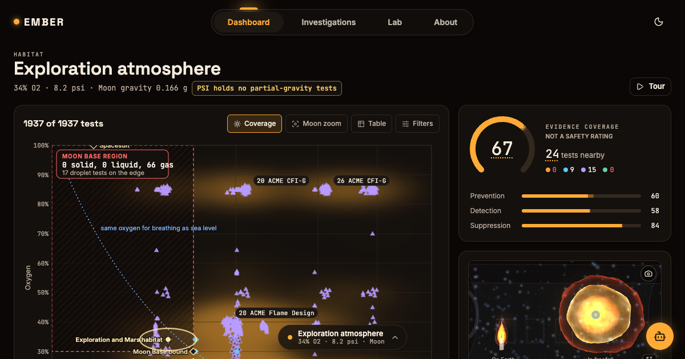

# EMBER

**What do we really know about fire where you are going?**

EMBER is a web dashboard that answers one question: for the crew habitat I care about, what does NASA's microgravity fire evidence cover, what does it tell me, and where are the gaps? Pick a habitat. EMBER scores the evidence near it, maps every real flight test, ranks the 24 combustion investigations, and lets a live language model answer questions using only that evidence, with every sentence checked against its source. Every number on screen opens the NASA rows it came from.

Built by team **Low Cortisol Gng** for the NASA Space Apps Challenge 2026, challenge "Flame in Freefall: SI-Powered Fire Safety Insights from Microgravity Combustion Data". Built with NASA open data from the PSI repository. NASA does not endorse this project.



- Live site: https://ember-two-eta.vercel.app
- What the science lead still has to read and approve: `REVIEW-CHECKLIST.md`.
- The build plan the team worked from: `plan.html` in this repository.

## How EMBER answers the challenge

The challenge asks teams "to build an SI-powered, web-based dashboard that summarizes, ranks, and interprets combustion science investigations to deliver critical foundational insights for fire safety". It then names three abilities and one optional one.

| The challenge asks for | Where EMBER does it |
|---|---|
| Summarize, rank and interpret the investigations | Plain summaries on every investigation page. A ranking with "Why this rank". Insight cards with every number sourced. |
| "Identify investigations most relevant to the fire safety needs of habitable crew environments, including spacecraft, space stations, bases on the lunar and Martian surfaces, and pressurized rovers" | Pick a habitat. The presets are those environments. The ranking, the coverage score and the map all answer for the one chosen. |
| "Extract data that supports predictive modeling of flammability and fire scenarios in space exploration" | The whole normalized dataset as one CSV (`public/data/tests.csv`). The Lab's models, each checked against the real tests. |
| "Highlight research that informs the development of next-generation fire safety controls and equipment" | "What this informs" on every investigation, and a filter by equipment. |
| "Your dashboard could also address potential applications of the PSI data to fire safety on Earth" | The Earth screen, led by three NASA spinoffs. |

## How it uses NASA data

All data comes from NASA's Physical Sciences Informatics (PSI) repository at psi.nasa.gov. It needs no key and no login.

- 24 combustion investigations, out of 133 investigations in PSI.
- 22 experimental tables with 2,009 rows, one row per real flight test. They become 2,031 normalized tests, because a row that lists several oxygen levels for one test day becomes one test per level, and note rows are kept apart.
- Three endpoints: the investigation search listing, the investigation record, and the experimental table download.

The PSI service does not allow calls from a browser on another site. So `npm run fetch` downloads everything once, and the snapshot is committed. The site reads only the committed snapshot and never depends on PSI being up. The raw cell is kept beside every value EMBER read from it.

Numbers the story rests on, all recomputed from the NASA files by the build:

| Number | Value |
|---|---|
| Highest oxygen in a solid material test | 22.2 percent, BASS-II, over 129 tests |
| Tests inside the Moon Base region, 30 percent oxygen or more at 10.2 psi or less | 66, all gas flames. 0 solid. 0 liquid. |
| Droplet tests just outside that region | 17 FLEX tests at 10.3 to 10.5 psi |
| Highest oxygen tested anywhere | 85 percent, in inverse gas flames, where it is the oxidizer stream and not a cabin |
| The d-squared law against FLEX | Median of predicted over measured burn time 0.951, over 196 tests |
| Tests with an assumed atmosphere at the cabin air point | 722 |

## The score and the ranking, in brief

**Evidence Coverage** measures how much real flight evidence sits close to the chosen atmosphere, on a scale of 0 to 100. Each test gets a weight that falls with its distance from the habitat in oxygen and pressure. A test that rests on an assumed value counts at half weight. It is not a safety rating, and EMBER says so beside the score every time.

The **relevance ranking** is a transparent heuristic with four parts: how many of an investigation's tests sit near the habitat, its fuel type, its pillar, and how much data it has. Every ranked card shows the four parts.

Every formula, constant and assumption is on the Methods screen of the app.

## Drill-through

Every mark on every chart and every number from data opens a panel with the tests behind it. Three levels: the mark, one investigation, one test with its raw NASA row and a link to psi.nasa.gov. The habitat and the drill path both live in the address, so any view can be shared as a link.

## The live model

On the Ask screen the evidence answer appears at once, built in the browser with no model. A live language model may then write three to six sentences.

- The model is reached through OpenRouter from one server function on Vercel (`api/ask.ts`). First choice `anthropic/claude-haiku-5.5`, backup `openai/gpt-6-luna`.
- The browser sends the question, the habitat and a list of evidence ids. The function looks up the evidence text itself, so the model only ever sees text EMBER built from NASA data.
- The browser checks the answer sentence by sentence. A sentence is removed when it cites no source or an unknown one, holds a number that is not in its source, says safe or unsafe, or shares too few words with its source.
- If the model fails, is slow, or its answer fails the check, the evidence answer stands. The site is complete without the model.
- Retrieval is keyword search with alias expansion, which always works. On top of it, a small open embedding model (`Xenova/all-MiniLM-L6-v2`) runs in the browser in a Web Worker for search by meaning. Its files and its runtime are served by the site itself, so nothing is fetched from another host.
- Limits: one firewall rule of 8 requests a minute per address, and a daily dollar limit on the key. An answer costs about $0.0003.
- The key is typed by the owner into Vercel. It is never in this repository.

## The fireball

The Brief opens on a fireball: a burning fuel droplet in freefall, drawn by shader code in the browser with three.js. It is an SI-generated illustration and carries a visible label. It changes with the habitat controls, driven by the NASA tests near the chosen atmosphere, and three sourced numbers beside it say so.

## How to run it

Node.js 24 and npm 11.

```sh
npm install
npm run dev          # the site on http://localhost:5173, with a mock model that calls nothing
npm test             # unit tests, both levels of insight verification, the server tests
npm run build        # type check and build into dist/
npm run ci           # everything the deploy runs: tests, data check, style, tokens, build, secrets
```

Data, only when the NASA snapshot should be refreshed:

```sh
npm run fetch        # downloads the PSI records and tables. Manual only.
npm run build:data   # normalizes them and writes the files in public/data
npm run build:embeddings  # embeds the search documents for search by meaning. Run it after build:data.
npm run data:report  # prints the headline numbers beside the values in the plan
```

Manual scripts that need the live site:

```sh
npm run build:pinned -- --site <production address>   # writes pinned answers for the six example chips
npm run eval:ask -- --site <production address>       # runs the evaluation set
```

## Project structure

```
api/                 the two Vercel functions, thin wrappers
server/              the request flow, the prompt, the model chain and their tests
scripts/             the data pipeline and the build checks
data/raw/            the PSI records and tables as fetched, with a manifest and a hash per file
data/manual/         hand-made files: habitats, assumptions, pillars, glossary, resources
public/data/         the generated files the site reads
public/models/embed/ the search model files, served by the site itself
src/lib/             pure functions: parse, units, coverage, ranking, drill, droplet, retrieve, grounding
src/components/      the component set
src/screens/         Brief, Map, Investigations, Detail, Compare, Lab, Ask, Earth, Methods
src/three/           the fireball, its colour ramp and its inputs
src/styles/theme.css every design token, light and dark
plan.html            the build plan. Not part of the site.
```

## Limitations

- The Evidence Coverage score counts evidence. It is not a safety rating. EMBER never says anything is safe or unsafe.
- The ranking is a heuristic. Its weights are the team's judgment.
- The PSI test tables are summaries, not the full datasets.
- Some atmospheres are assumed, because the table does not state them. They are marked and count at half weight.
- PSI holds no partial-gravity combustion tests. Nothing here describes a flame on the Moon or Mars.
- The pillar mapping, the equipment tags, the plain summaries and the declared assumptions are SI drafts that carry the status "needs human check" until the team confirms them.
- The answer checker proves that ids and numbers match the evidence. It cannot prove that a sentence means what its source means.

## SI disclosure

Super Intelligence (SI) is the event's word for AI. The organizers confirmed to the team on 14 November 2026 that using AI is allowed.

- The code, the build scripts and the tests were drafted with an SI coding assistant (Claude Code with the Fable 5.2 model) during the event and reviewed by the team.
- The plain summaries, the insight wording, the glossary and the context cards were drafted by SI from PSI text and NASA pages. The numbers in them are computed from the data.
- Two live language models, reached through OpenRouter, answer questions on the Ask screen from the NASA evidence shown and nothing else.
- The fireball is drawn by SI-assisted shader code and carries the label "SI-generated illustration".
- Every generated data file carries a `generatedBy` field. Source files carry a one-line SI header.

The full statement is in `SI-DISCLOSURE.md`. Sources are in `SOURCES.md`.

## Team

Low Cortisol Gng, four people, all adults. NASA Space Apps Challenge 2026.

## Licence

Apache 2.0. See `LICENSE`. Most PSI records carry the CC0-1.0 licence, shown on each investigation page. No NASA logo, insignia or mission patch is used anywhere.
