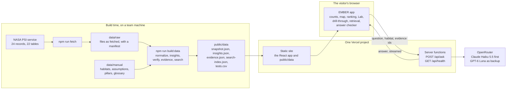
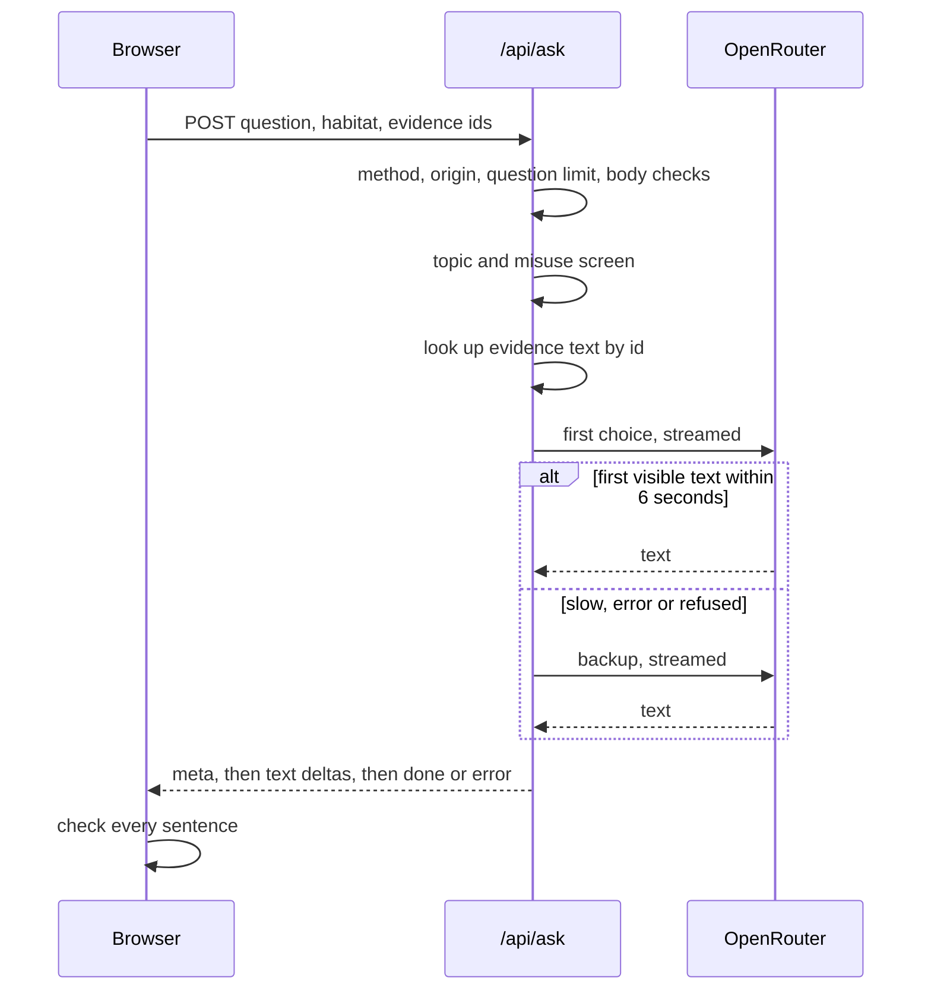

# EMBER architecture

This is how EMBER is built, as it stands on `main` after the NASA Space Apps Challenge 2026. It was written from the code, not from the plan. Where the build moved away from the plan, a short note says so. The plan the team worked from is `plan.html` in this repository.

- Live site: https://ember-two-eta.vercel.app
- What EMBER is for, in one line: pick a crew habitat and see which NASA microgravity fire tests ran in similar air, what they cover, and where the gaps are.

## 1. The whole system on one page

In five sentences:

1. A script downloads NASA's combustion records and test tables once, and the pipeline turns them into a few JSON files and one CSV.
2. Those files are committed and shipped with the site on Vercel, so the site never calls NASA at run time.
3. The browser does almost everything itself: the nearby counts, the coverage score, the ranking, the map, every drill-through, the Lab, the flame picture and the evidence search.
4. Only a question in the chat panel calls the server, which asks a language model through OpenRouter to write a short answer from evidence that EMBER chose.
5. The browser then checks that answer sentence by sentence and drops anything it cannot trace to its source.

## 2. The data build pipeline

### 2.1 Steps

| Step | Command and code | What it does |
|---|---|---|
| 1. Fetch | `npm run fetch`, `scripts/fetch-psi.mjs` | Downloads the investigation listing, the 24 combustion records and their 22 experimental tables from `psi.nasa.gov`. Manual only, never part of a deploy. Writes `data/raw/` and `data/raw/manifest.json` with a SHA-256 hash per file. Contact email addresses are dropped here. |
| 2. Normalize | `scripts/lib/normalize.mjs`, `buildSnapshot` and `normalizeTable` | Reads every table with a per-table rule, parses numbers with one tolerant parser, converts units, applies the declared assumptions and builds the snapshot. |
| 3. Insights | `scripts/lib/insights.mjs` | Computes the twelve finding cards (I1 to I12) from the snapshot. The wording is filled in from the numbers. |
| 4. Verify | `scripts/lib/verify.mjs`, `verifyInsights` | Level 1 recomputes every card number from the snapshot. Level 2 recomputes the headline cards straight from the raw CSV files with its own short strict code, so it can catch bugs in the normalizer. The build fails on any mismatch. |
| 5. Evidence | `scripts/lib/evidence.mjs`, `buildEvidence` | Builds the one evidence bundle the chat cites. |
| 6. Search | `scripts/lib/evidence.mjs`, `buildSearchIndex` | Builds the keyword search documents. Several documents can point to one evidence item. |
| 7. Embeddings | `npm run build:embeddings` | Adds meaning vectors to the search index. Run on a team machine after step 6. The pipeline keeps the committed vectors when the search build id has not changed. |

`scripts/lib/pipeline.mjs` runs steps 2 to 6 as one function, `buildAll`. The same inputs always give byte-identical files. `npm run build:data` writes them. `npm run check:data` rebuilds them in memory and fails if any committed file differs, which catches a hand edit or a forgotten rebuild.

### 2.2 The files the site reads

| File | Holds | Loaded |
|---|---|---|
| `public/data/snapshot.json` | Investigations, every test with its raw NASA row, table profiles, habitats, assumptions, dropped rows, label corrections, glossary, resources | At startup |
| `public/data/insights.json` | The twelve finding cards, each with its numbers, its evidence and a verified flag | At startup |
| `public/data/evidence.json` | 87 citable items with an id and exact text: 12 insights, 24 investigations, 28 glossary terms, 6 habitats, 6 hardware families, 6 context cards and 5 method notes | When the chat opens |
| `public/data/search-index.json` | Search documents, aliases and the meaning vectors | When the chat opens |
| `public/data/pinned-answers.json` | Reviewed answers for the example chips in the chat. Built by hand with `npm run build:pinned` against the live site. | When the chat opens |
| `public/data/tests.csv` | The whole normalized dataset, for download | On request |

The data files are fetched with the build id in the query string (`src/state/data.tsx`), so a browser never mixes numbers from two builds. The build id is a short hash of the snapshot, set in `vite.config.ts`.

### 2.3 The numbers at this snapshot

- Fetched 14 November 2026. 24 investigations (19 microgravity, 5 ground), 22 tables, 2,009 table rows.
- 2,029 normalized tests. A row that lists several oxygen levels for one test day becomes one test per level. Note rows are kept apart. 2 rows that record no test are dropped and listed on About.
- 1,936 tests have an oxygen value. 886 rest on at least one assumed value, 721 of them on an assumed oxygen value.
- 6 column headers that lost symbols in NASA's files are corrected and listed on About.

## 3. The normalized test schema

Every test, from any table, has the same shape. The type is `Test` in `src/types.ts`.

| Field | Meaning |
|---|---|
| `id` | `accession:tableIndex:rowIndex`, with a letter suffix when one row became several tests, for example `PSI-69:0:12` |
| `accession`, `table`, `rowIndex` | Where the row lives in PSI |
| `label` | A short readable name for the test, built by the table's rule |
| `fuel`, `fuelClass` | The fuel or material, and one of solid, liquid, gas, aerosol or unknown |
| `o2`, `o2Source` | Oxygen as a fraction from 0 to 1, and whether it came from the table or was assumed |
| `pressureAtm`, `pressureSource` | Pressure in atmospheres, and its source in the same way |
| `flowCmS` | Air flow in cm per second, where the table gives it |
| `diluent` | The balance gas as fractions of nitrogen, carbon dioxide and helium, where known |
| `outcome` | What happened, such as extinction or burned out, where the table says |
| `extra` | Table-specific values, such as the droplet diameters and burning rate for FLEX |
| `raw` | The whole row exactly as NASA wrote it, header by header |
| `flags` | Notes on how the row was read: `approximate`, `range`, `day-level`, `typo-fixed`, `helium-balance`, `continuation`, `material-inherited`, `oxidizer-stream` |

NASA's numbers are never overwritten. A drill-through always ends on the `raw` row beside what EMBER read from it.

## 4. Assumptions and their review status

Some tables leave out oxygen, pressure or both. For those, a declared default lives in `data/manual/atmosphere-defaults.json`, one entry per investigation, each with a reason, a source and a status. The normalizer fills a value only where the table cell is empty, and marks it `assumed`. Assumed values are drawn as hollow marks on the map and count at half weight in the coverage score.

All 12 entries were reviewed by the EMBER team on 15 November 2026 against the PSI records and the papers named in each source. A combustion researcher should still confirm them before any design use.

| Status | Count | Entries |
|---|---|---|
| Confirmed | 9 | BASS, SAME, SAME-R, SPICE, SLICE (21% oxygen, 1 atm), Saffire-I, Saffire-II, BASS-II and ACME s-Flame (1 atm, oxygen from the table) |
| Changed | 3 | DAFT keeps 1 atm but no longer assumes oxygen, because its bags held nitrogen. Saffire-III now assumes 21.2% oxygen, the station air recorded at hatch closing. ACME BRE no longer assumes a pressure, because its table does not say which test ran at which pressure, so those tests stay off the map. |

Two flame gates in `src/three/flameParams.ts` were reviewed the same day and turned on: the ACME column "Tad (K)" is read as the adiabatic flame temperature, and the FLEX burning rate is read in mm² per second.

The full reasoning, quotes and sources for every entry are in [explainers/EMBER-assumptions-review-guide.md](explainers/EMBER-assumptions-review-guide.md). That guide was written before the review and keeps its decision sheet as a record. The statuses above are the ones in the code.

## 5. The app

React 19, Vite, TypeScript and Tailwind. Charts are hand-built SVG with d3 scales. The flame is three.js. Fonts are bundled from npm, so nothing loads from a font host.

### 5.1 Routes

Defined in `src/routes.tsx` and wired in `src/App.tsx`. Every screen behind the start page is its own lazily loaded chunk, and every route has its own error fallback (`src/components/RouteError.tsx`), so one failed screen does not take the site down. A chunk left stale by a new deploy reloads the page once (`src/lib/chunkReload.ts`).

| Route | Screen | File |
|---|---|---|
| `/` | Start page: the halftone sky, the name and one way in | `src/screens/Hero.tsx` |
| `/dashboard` | The dashboard and the map | `src/screens/Dashboard.tsx` |
| `/investigations` | The 24 investigations, ranked for the habitat | `src/screens/Investigations.tsx` |
| `/investigations/:accession` | One investigation: summary, what varied, the test table, sources | `src/screens/InvestigationDetail.tsx` |
| `/investigations/compare` | Two or three investigations side by side | `src/screens/Compare.tsx` |
| `/lab` and `/lab/:tool` | The Lab: droplet, extinction, gravity, flame | `src/screens/Lab.tsx` |
| `/about` | Everything that explains EMBER, in tabs | `src/screens/About.tsx` |

Old addresses from the plan (`/map`, `/ask`, `/compare`, `/earth`, `/methods`) redirect to the screen that now holds their content and keep the habitat and any open drill panel.

### 5.2 State

There is no state library. The address is the state, which makes every view a shareable link.

- **The habitat** lives in the query string as `h` for a preset, or `o2`, `p` and `g` for a custom one, plus `flow` and `focus`. `src/state/scenario.ts` parses, clamps and validates it, falls back to the ISS cabin, and collapses custom values back to `h=` when they equal a preset.
- **The drill path** lives in one `drill` parameter (`src/lib/drill.ts`, `encodeDrill` and `decodeDrill`). Opening a level pushes one history entry, so Back steps up one level.
- **The data** is loaded once by `DataProvider` in `src/state/data.tsx`, which builds lookup maps by accession and test id and checks the schema version.
- **Derived values** come from hooks in `src/state/hooks.ts`: `useScenario`, `useCoverage`, `useRanking` and `useDrill`. Each is a memoized call into a pure function in `src/lib`.

The six habitat presets are in `data/manual/habitats.json`: ISS cabin (21%, 14.7 psi), Shuttle EVA preparation (26.5%, 10.2 psi), Exploration atmosphere (34%, 8.2 psi, Moon gravity), Moon Base bound (30%, 10.2 psi), Mars surface habitat (34%, 8.2 psi, Mars gravity) and Spacesuit (100%, 4.3 psi).

### 5.3 The shell

`src/components/AppShell.tsx` wraps every screen behind the start page. It holds the top bar with the wordmark, the navbar and the habitat picker, the chat launcher (a small robot at the bottom right) and the drill panel. On every route change, focus moves to the page heading and the page title is announced.

### 5.4 The dashboard and the map

The dashboard leads with counts, not a score. It shows how many NASA test records sit near the chosen habitat, in all and by fuel class, one plain statement of what is missing, the caveats (assumed values, inverse flames) and the three investigations to read first. Below that sit search, filters by investigation, fuel class, pillar and hardware, a table of exactly the tests in view and a "Download this view (CSV)" button.

The Atmosphere Map (`src/components/AtmosphereMap.tsx`) draws every test with an oxygen value as a mark on oxygen against pressure, on a log pressure axis, beside the habitat. Hollow marks are assumed values. It shows the normoxic curve, the Moon Base region and an optional coverage glow. It zooms with a pinch, Ctrl or Command and the wheel, or Shift and a drag, and pans with a drag. Layout lives in `src/lib/mapLayout.ts`, `src/lib/mapScope.ts` and `src/lib/zoom.ts`.

### 5.5 Drill-through

Every mark on every chart and every number from data opens the drill panel (`src/components/DrillPanel.tsx`). It has three levels with breadcrumbs: the mark and its count, one investigation's tests, and one test with its raw NASA row and a link to psi.nasa.gov. One function, `resolveDrill` in `src/lib/drill.ts`, decides what lies behind a mark, and the charts count with the same filters, so the number on a chart and the rows in the panel cannot differ.

### 5.6 The Lab

`src/screens/Lab.tsx`, with its selections in `src/lib/lab.ts`. Four tools, each with one short line and a Notes button for the model and its limits:

1. **Droplet burn.** A FLEX droplet shrinking by the d-squared law, for a chosen fuel, diluent family and oxygen level, against the FLEX tests within 3 points of oxygen. A second chart checks the law against every FLEX test.
2. **Extinction.** The ratio of extinction diameter to starting diameter against oxygen, binned with medians.
3. **Gravity pairs.** Saffire-II burn lengths in microgravity against normal gravity, sample by sample.
4. **Habitat flame.** The three.js fireball for the chosen habitat (`src/three/Fireball.tsx`), driven by `flameParams` from the nearby FLEX and ACME tests, with three sourced readouts. It carries a visible SI mark and falls back to a poster when WebGL is missing or too slow.

### 5.7 About

`src/screens/About.tsx` and `src/screens/about/`. Eight tabs: Overview, Findings, Data and methods, Visuals, Live answers, Back on Earth, SI disclosure and Sources. Data and methods holds the pipeline, the formulas, the nearby rule, the coverage score, the assumptions, the corrections, the values kept as NASA wrote them, the tests left off the map, and the limits. A link can name a tab or one section inside it, for example `/about?section=assumptions`.

### 5.8 The chat panel

`src/components/chat/ChatLauncher.tsx` and `ChatPanel.tsx`. The panel and everything it needs load on first open, so the rest of the site never pays for them. A question in the address (`?ask=...`) opens the panel and asks it. The flow for one question:

1. **Topic screen.** The same keyword screen the server uses (`src/lib/topic.ts`) refuses an off-topic question or a request to change the rules at once, and sends nothing.
2. **Retrieval** (`src/lib/retrieve.ts`). Keyword search with glossary aliases always runs. When the small embedding model (`Xenova/all-MiniLM-L6-v2`, run in a Web Worker from files the site serves itself) has loaded, a meaning search is merged in by reciprocal rank. It also reads oxygen, pressure, material and investigation names out of the question. If nothing real is found, EMBER says so and calls no model.
3. **Evidence first.** The matching evidence and rows show at once, with no model.
4. **Pinned answer.** An example chip with a reviewed pinned answer shows that answer and calls no model.
5. **Live answer.** Only when `/api/health` says a model is configured, the browser sends the question, the habitat and up to 7 evidence ids to `/api/ask`. A per-browser question limit applies first, and answers are cached for the session.
6. **The check** (`src/lib/grounding.ts`, `checkAnswer`). Each sentence is removed if it cites no id or an unknown one, holds a number that is not in its source, uses safe or unsafe or safety-rating language, or shares too few words with its source (fewer than 3, or under 35 percent). Two or more surviving sentences make a checked answer marked "Sources and numbers checked". The fixed refusal sentence shows as a refusal. Anything else is dropped and the evidence stands as the answer.

## 6. The core calculations

A summary. Every formula is also on the About screen, and [explainers/EMBER-calculations-explained.md](explainers/EMBER-calculations-explained.md) walks through each one with worked numbers.

| Calculation | Rule | Code |
|---|---|---|
| Distance | dx = oxygen gap ÷ 0.04, dp = ln(test pressure ÷ habitat pressure) ÷ 0.25, d = √(dx² + dp²). About 4 points of oxygen or about 25 percent in pressure is one unit. Gravity is not part of it. | `src/lib/coverage.ts`, `distance` |
| Nearby | A test is nearby when d ≤ 1. The dashboard counts nearby tests by fuel class, with assumed and inverse-flame subsets beside them. Nearby means NASA burned something in similar air. It is not a test of that habitat and not a safety rating. | `src/lib/nearby.ts`, `nearbyTests`, `summarizeNearby`, `gapStatement` |
| Coverage | Each test weighs a × exp(−0.5 × d²), with a = 1 from the table or 0.5 if assumed. The weight counts in full toward its investigation's main pillar and at 0.3 toward a secondary pillar, or toward every pillar for a fundamentals study. Per pillar, score = 100 × (1 − exp(−N ÷ 10)), where N is the sum of weights. Overall is a 0.4, 0.3, 0.3 blend of prevention, detection and suppression. Shown on About, not on the dashboard. | `src/lib/coverage.ts`, `computeCoverage` |
| Ranking | score = 100 × (0.45 A + 0.25 F + 0.2 P + 0.1 D). A is 1 − exp(−n ÷ 5) over the investigation's test weights. F is the fuel part (solid 1.0, aerosol 0.8, liquid 0.6, gas 0.4, ground studies 0.3). P is 1, or 0.5 when a pillar focus is set and does not match. D grows with the log of the test count up to 500. Every card shows the four parts. | `src/lib/ranking.ts`, `rankInvestigation` |
| Droplet law | d(t)² = d0² − K × t. Model burn time to extinction = (d0² − dExt²) ÷ K. Checked against every FLEX test with all four values. The median of predicted over measured time is 0.951 over 195 tests. | `src/lib/droplet.ts`, `validateDSquared` |
| Extinction | Extinction ratio = dExt ÷ d0, only for tests that ended in extinction, binned by oxygen (10 to 38 percent in 4 point bins) with a median per bin. | `src/lib/droplet.ts`, `src/lib/lab.ts`, `extinctionBins` |
| Flame picture | The fireball's speed, heat and steadiness come from three readouts: the median burning rate of nitrogen-diluted FLEX tests within 3 points of oxygen (drawn on a line between tested levels when there is none), how many of those tests ended in extinction, and the median ACME flame temperature within 5 points of oxygen, leaving out inverse and cool flames. Pressure thickens the haze only. | `src/lib/flame.ts`, `src/three/flameParams.ts` |

## 7. The /api/ask server function

`api/ask.ts` and `api/health.ts` are thin wrappers. The logic lives in `server/` so the tests and the dev server run the same code as Vercel.

### 7.1 The guardrails, in order

`handleAsk` in `server/handler.ts`:

| Check | Rule | Code |
|---|---|---|
| Method | POST only, anything else gets 405 | `server/handler.ts` |
| Origin | The Origin header must match the host. Without it, Sec-Fetch-Site must be same-origin or the Referer must match. A request with none gets 403. This stops casual reuse, not a determined script. | `fromOwnSite` |
| Question limit | 6 a minute and 60 an hour per address, held in each running instance's memory, 429 with Retry-After. The chat panel keeps the same limit per browser. Neither is a hard stop. | `src/lib/rateLimit.ts` |
| Body | At most 4,000 bytes, a question of 1 to 300 characters, 1 to 8 evidence ids, a habitat with oxygen from 12 to 100 percent, pressure from 3 to 15 psi and a known gravity | `server/validate.ts` |
| Topic and misuse | A keyword check against EMBER's own vocabulary refuses off-topic questions and attempts to change the rules with 422, before any model call | `src/lib/topic.ts`, `screenQuestion` |
| Evidence | Only ids that match the id pattern and exist in the bundle are kept, without duplicates, and dropped from the end until the text is under 9,000 characters. Evidence text is never accepted from the browser. | `pickEvidence` |
| Key | Without `OPENROUTER_API_KEY` the function answers 503, and `/api/health` reports `configured: false` so the browser hides the live answer | `handleHealth` |

### 7.2 The model call

- The prompt is in `server/prompt.ts`. The system message tells the model to use only the numbered evidence, write 3 to 6 short sentences, cite an id after every sentence, copy every number exactly, never call anything safe or unsafe, never call coverage a safety rating, and answer with one fixed refusal sentence when the evidence does not answer. The habitat line is built by the server from the request numbers, and the question is fenced and cut to 300 characters.
- The model chain is in `server/chain.ts`, with settings in `server/config.ts`. First choice `anthropic/claude-haiku-5.5`, backup `openai/gpt-6-luna`, both through OpenRouter. Reasoning is off and the answer is capped at 600 tokens. The first choice gets 6 seconds to its first visible text and 25 seconds in all, and the backup gets 5 and 20. EMBER cancels a slow call itself, because OpenRouter's own fallback fires on errors only.
- The answer streams back as server-sent events: `meta` (the model and the evidence ids), `delta` (text), then `done` or `error` (`server/sse.ts`). The browser stops waiting after 12 seconds with no first word or 30 seconds in all (`src/lib/ask.ts`).
- The function logs one line per request with the time, the model, the status and the duration. It never logs the question or a header.
- `MOCK_MODELS=1` swaps in a local mock that calls nothing, for local work.

## 8. Deployment on Vercel

- One Vercel project holds the static site and the two functions (`vercel.json`). The framework is Vite and the output is `dist/`.
- The Vercel build command is `npm run ci`, so every check below runs on every deploy, and a red check stops the deploy while the last good site stays live.
- `api/ask.ts` may run for 60 seconds and ships with `public/data/*.json`, so the function reads the same evidence file the site serves. `api/health.ts` ships with `evidence.json` only.
- One rewrite sends every path that is not a real file to `index.html`, so clean paths such as `/investigations/PSI-69` work.
- The OpenRouter key is set by the owner in Vercel's environment settings for production. It is never in the repository, and it has no `VITE_` prefix, so it cannot reach the browser's code. Preview deployments have no key, so they show the site without the live answer.
- The README also describes a Vercel firewall rule on `/api/ask` and a daily credit limit on the key. Both live in account settings, not in this repository.
- There is no database. The data is a committed snapshot, the address holds the state, and the function holds the key.

## 9. Testing and CI

There are no GitHub Actions. CI is the Vercel build. `npm run ci` runs, in order:

| Step | What it checks |
|---|---|
| `npm test` | Vitest, about 230 tests in `src/lib/*.test.ts`, `src/routes.test.tsx`, `scripts/data.test.ts` and `server/server.test.ts`. They cover parsing, units, coverage, ranking, nearby counts, drill resolution, the answer checker, the topic screen, the server flow, routes, zoom and both levels of insight verification. |
| `npm run check:data` | The committed generated files match a fresh build byte for byte |
| `npm run check:style` | No em dash or semicolon in user-facing text, comments, the main Markdown files, the manual data or the insight wording. Text quoted from NASA is allowed. |
| `npm run check:tokens` | Every colour comes from a design token in `src/styles/theme.css`, except in the fireball's colour ramp |
| `npm run build` | Copies the ONNX runtime files, type checks and builds |
| `npm run check:secrets` | Scans the repository and the built site for key-shaped strings and for `VITE_` names that look like secrets |

Two manual scripts need the live site: `npm run build:pinned` writes the pinned chip answers, and `npm run eval:ask` runs the evaluation question set. The last evaluation is recorded in `src/config/evaluation.ts` and the raw runs are in `eval-results/`.

## 10. Where the build differs from the plan

| The plan said | What was built |
|---|---|
| A Brief screen at `/` led with the fireball and the coverage dial | A plain start page at `/`, then a dashboard that leads with nearby counts by fuel class and a gap statement. The coverage score moved to About and the fireball moved to the Lab. |
| Separate Map, Ask, Earth and Methods screens | The map sits on the dashboard. Ask became a chat panel on every screen. Earth and Methods became tabs on About. The old routes redirect. |
| Compare at `/compare` | Compare at `/investigations/compare` |
| 2,009 tests | 2,009 table rows become 2,029 tests, because day-level rows split by oxygen and 2 rows that record no test are dropped |
| Assumptions with the status "needs human check" | All 12 reviewed on 15 November 2026: 9 confirmed and 3 changed. Both flame gates turned on. |
| One Vercel firewall rule of 8 requests a minute, and a daily credit limit on the key | Those, plus a question limit in the function and in the browser, a topic and misuse screen before any model call, and a stricter origin check |
| Three lanes of work and one session | The same structure, built over the event weekend in about a dozen pull requests |

The plan's other choices held: a committed snapshot, the raw cell beside every value, two-level verification, one evidence file, ids in and text looked up on the server, the checker in the browser, OpenRouter with a backup model, no database and no GitHub Actions.

## 11. Known limits

- Coverage and nearby counts measure evidence. They are not safety ratings, and EMBER never says anything is safe or unsafe.
- The ranking weights are the team's judgment.
- PSI test tables are summaries, not the full datasets.
- Assumed atmospheres were reviewed by the team, not by a combustion researcher.
- PSI holds no partial-gravity combustion tests, so nothing describes a flame on the Moon or Mars.
- Inverse flames count toward coverage. Their oxygen value is the oxidizer stream, not cabin air, and EMBER flags them.
- The pillar mapping, equipment tags and plain summaries are SI drafts still marked "needs human check".
- The answer checker proves that ids and numbers match. It cannot prove a sentence means what its source means.
- The question limit lives in each function instance's memory, so it is a best effort. The hard stop is the credit limit on the key.

## 12. Next steps

These were proposed in the pitch and are not built:

1. Estimate missing oxygen or pressure from similar tests with machine learning, always labelled as an estimate and never mixed with NASA's values.
2. Add new tests automatically as NASA publishes them, including Moon and Mars gravity tests.
3. A fire check for habitat designers that flags material and air combinations NASA has never tested and exports the evidence for a safety review.

Smaller follow-ups: a combustion researcher's review of the assumptions and the SI drafts, a shared rate limit store if traffic ever needs one, and a refresh of the snapshot with `npm run fetch` when PSI adds investigations.

## 13. Further reading

- [explainers/EMBER-calculations-explained.md](explainers/EMBER-calculations-explained.md): every calculation, explained simply, with worked numbers
- [explainers/EMBER-assumptions-review-guide.md](explainers/EMBER-assumptions-review-guide.md): the twelve assumptions and two flame gates, with sources
- [explainers/EMBER-explained-for-AI.md](explainers/EMBER-explained-for-AI.md): a short context file to give an AI assistant
- `SOURCES.md` and `SI-DISCLOSURE.md` at the repository root
